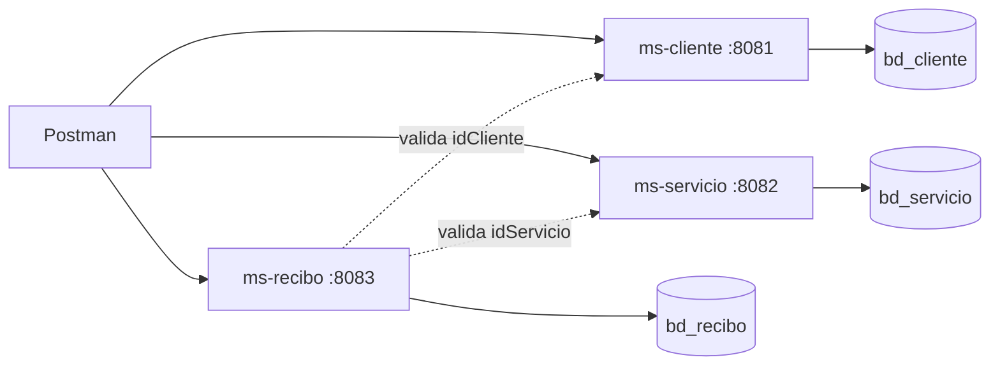

# Laboratorio 17 - Gestion de pagos de servicios

Tres microservicios Spring Boot 3.3 (Java 17, Maven, MySQL), cada uno con **su propia base de datos**:

| Microservicio | Puerto | Base de datos | Endpoint base |
|---|---|---|---|
| `ms-cliente`  | 8081 | `bd_cliente`  | `/api/clientes` |
| `ms-servicio` | 8082 | `bd_servicio` | `/api/servicios` |
| `ms-recibo`   | 8083 | `bd_recibo`   | `/api/recibos` |

Diagrama: `docs/diagrama-microservicios.svg` (abrir en el navegador).



## Requisitos
- JDK 17, Maven (o el incluido en IntelliJ), MySQL 8 en `localhost:3306`.

## Como abrir en IntelliJ
1. `File > Open` y seleccionar la carpeta `lab17-pagos-servicios` (el `pom.xml` raiz carga los 3 modulos). Si no los detecta: clic derecho en el pom raiz > *Add as Maven Project*.
2. Editar la clave de MySQL en `application-dev.yml` de los 3 modulos (por defecto `root` / `root`).
3. Ejecutar `ClienteApplication`, `ServicioApplication` y `ReciboApplication` (tres configuraciones Run). Las bases se crean solas en dev (`createDatabaseIfNotExist=true`, `ddl-auto: update`).

Por consola: `cd ms-cliente && mvn spring-boot:run` (repetir en los otros dos).

## Perfiles dev / prod

| Valor | dev | prod |
|---|---|---|
| Activacion | por defecto | `SPRING_PROFILES_ACTIVE=prod` |
| URL BD | `localhost:3306/bd_xxx` | `DB_URL` (variable de entorno) |
| Usuario / clave | `root` / `root` en el YAML | `DB_USERNAME` / `DB_PASSWORD` (env) |
| `ddl-auto` | `update` (Hibernate crea tablas) | `validate` (esquema con `db/init.sql`) |
| `show-sql` | `true` | `false` |
| Log `com.empresa` | DEBUG | INFO |
| URLs entre servicios (solo ms-recibo) | `localhost:8081` / `8082` | `MS_CLIENTE_URL` / `MS_SERVICIO_URL` |
| Puerto | 8081/8082/8083 | `SERVER_PORT` (mismo defecto) |

Ejemplo prod: `SPRING_PROFILES_ACTIVE=prod DB_USERNAME=app DB_PASSWORD=secreto java -jar target/ms-recibo-1.0.0.jar`

## Reglas del negocio
- Recibo: `idCliente`, `idServicio`, `periodo` (yyyy-MM, obligatorio), `monto` (> 0), `fechaVencimiento`, `estadoPago` (`PENDIENTE` | `PAGADO`).
- Todo recibo nace `PENDIENTE`. `PATCH /api/recibos/{id}/pagar` lo pasa a `PAGADO`.
- Al crear/actualizar un recibo, `ms-recibo` consulta a los otros servicios para confirmar que el cliente y el servicio existen (se desactiva con `servicios.validar-referencias: false`).
- Un recibo PAGADO no puede modificarse ni pagarse de nuevo (409).

## Respuestas HTTP
| Situacion | Codigo |
|---|---|
| Creado | 201 |
| Consulta / actualizacion / pago OK | 200 |
| Eliminado | 204 |
| Validacion fallida (monto <= 0, periodo vacio, JSON invalido) | 400 |
| Recurso inexistente (cliente, servicio, recibo) | 404 |
| Duplicado (DNI, nombre de servicio, recibo del mismo periodo) o recibo ya pagado | 409 |
| Otro microservicio caido | 503 |

## Prueba de aceptacion (Postman)
Importar `postman/Lab17.postman_collection.json` y ejecutar la carpeta **1. Prueba de aceptacion** en orden:
crear cliente > crear servicio > registrar recibo (PENDIENTE) > marcar pagado > consultar (PAGADO).
La carpeta **2. Casos de error** cubre 400, 404 y 409. Use *Run collection* y capture la pantalla de resultados como evidencia.

Ejemplo manual:
```
POST http://localhost:8083/api/recibos
{ "idCliente": 1, "idServicio": 1, "periodo": "2026-10", "monto": 45.50, "fechaVencimiento": "2026-11-15" }
PATCH http://localhost:8083/api/recibos/1/pagar
GET   http://localhost:8083/api/recibos/1
```

## Estructura
```
lab17-pagos-servicios/
 pom.xml  (agregador)
 ms-cliente/  ms-servicio/  ms-recibo/   (controller, service, repository, model, dto, exception)
 db/init.sql
 docs/diagrama-microservicios.svg
 docs/CONCLUSIONES_Y_SUSTENTACION.md
 postman/Lab17.postman_collection.json
```
